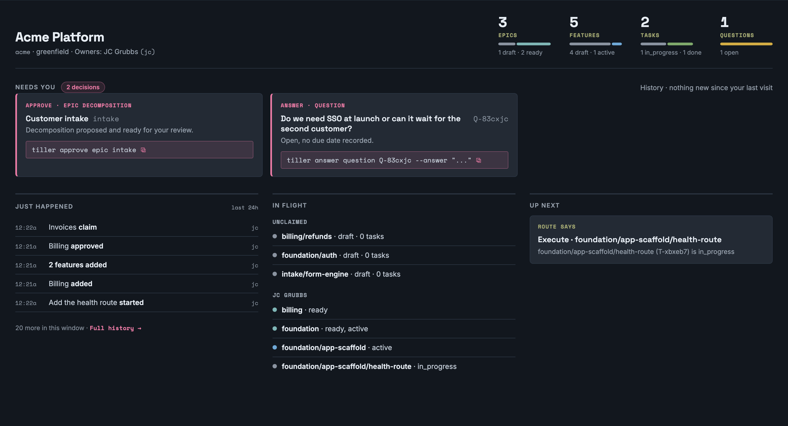

# Tiller

<picture>
  <source media="(prefers-color-scheme: dark)" srcset="./tiller-logo-inverted.svg" />
  
</picture>

[](https://github.com/madeintandem/tiller/actions/workflows/ci.yml)
[](./LICENSE)

Tiller is an opinionated SDLC workflow tool for humans and AI coding agents
working together. It holds the structure, the gates, and the state of a
software project. The agent does the reasoning. The human approves at the
gates. Everything it knows lives as files in your repo, under git, next to
the code it describes.



## The opinions

**Files are the source of truth.** Markdown for prose, YAML for state, git as
the spine. There's no database and no hosted service. `.tiller/` is a
directory in your repository, so a clone carries the whole plan with it, and
nothing about that plan lives anywhere a clone can't reach.

**Prose and state never share a file.** A node's `.md` is yours: intent and
acceptance criteria, in your words. Its `.yml` is Tiller's: status,
ownership, and gate results, mutated by the machine. That split is what lets
the CLI churn state all day without touching a sentence a human wrote, and
it's what keeps two people's work from colliding in a merge.

**One tree, progressively elaborated.** Epics, then features, then tasks. An
epic is narrative. A feature is narrative plus a specification and an
acceptance contract. A task carries the implementation detail. Features get
specified and broken into tasks just in time, when their turn comes, and not
a moment before.

**Tiller is a gatekeeper, not an orchestrator.** It declares and records gates
(build, tests, evals, review). It never runs the agent's reasoning, and it
never drives someone else's tooling on the agent's behalf. Required gates
block done. Optional review gates are visible and non-blocking, which is to
say they're encouragement with a paper trail.

**The done gate is the PR merge.** An agent can drive work right up to the
edge of done and turn every gate green. Only a human merge crosses to done,
and Tiller learns about it by watching git, not by being told.

**Model and harness agnostic.** The agent surface is the `tiller` CLI, a set
of skills served by `tiller guide`, and a generated `orientation.md` in the
repo. Claude Code, Codex, and a bare shell with a local model all see the
same thing, because nothing in Tiller depends on a capability only one vendor
has. (Today `tiller join` auto-wires Claude Code. Another harness adapter is a
small addition, and the bare-shell path works without one.)

**Tiller guides; it does not control.** It can't make an agent follow the
process and it doesn't pretend it can. The developer drives, the developer
answers for the result, and the one boundary that actually holds is the merge
a human performs. The name isn't an accident. A tiller steers the boat, but
somebody's hand has to be on it.

## Install

The current release is **v0.21.2**. Install it with either path below, then
check that `tiller --version` reports 0.21.2. The
[Quickstart](https://madeintandem.github.io/tiller/quickstart/) walks a
scratch project from install to a merged, synced task, and the
[source walkthrough](https://madeintandem.github.io/tiller/source-quickstart/)
covers the same contract in more detail from a source build.

macOS, with Homebrew:

```sh
brew install --cask madeintandem/tap/tiller
```

macOS or Linux, with the one-shot installer. It fetches the right binary for
your platform and verifies its checksum before placing it:

```sh
curl -fsSL https://raw.githubusercontent.com/madeintandem/tiller/main/install.sh | sh
```

Go users (Go 1.27 or later) can
`go install github.com/madeintandem/tiller/cmd/tiller@latest`.
Checksummed binaries for macOS and Linux, amd64 and arm64, are on the
[releases page](https://github.com/madeintandem/tiller/releases). Tiller is a
single static binary with the web console and the skills embedded, so there's
no runtime to install and nothing else to place.

Distributed third-party components retain their upstream licenses. Full
licenses and copyright notices are in
[THIRD_PARTY_NOTICES.txt](./THIRD_PARTY_NOTICES.txt), included in release
archives and served by the embedded console at `/THIRD_PARTY_NOTICES.txt`.
Tiller's own code is licensed under Apache 2.0.

## Your first tree

```sh
mkdir acme && cd acme && git init -b main
tiller init --name "Acme Platform" --key acme --kind greenfield
tiller add contributor robin --name "Robin Hale"   # register yourself on the committed roster
tiller join --as robin                             # select that identity here; wire your coding agent
mkdir -p .tiller/design
printf '# Acme\n\nA small application with a health route, sign-in, and invoicing.\n' \
  > .tiller/design/overview.md
git add -A && git commit -m "Initialize Acme planning"
tiller check readiness
tiller guide
```

Use your own contributor ID and name. `init` scaffolds `.tiller/` and
generates `.tiller/orientation.md`, the agent's front door. `join` writes a
small managed block into your `AGENTS.md` and, for Claude Code today, installs
eleven gitignored skill shims where the harness discovers them; any other
harness reaches the same skills through `tiller guide`. With a design input
and a contributor in place, readiness passes and `tiller guide` names the
`decompose` skill. Ask your agent to run it: it proposes an epic and feature
tree as drafts for you to approve. (For an existing codebase, use
`--kind brownfield`. There `tiller guide` starts with `derive-baseline`, so
existing docs and code are reconciled into a baseline you review before
decomposition.) Then:

```sh
tiller serve
```

and watch the tree appear. Once you approve the Foundation epic and the plan
for its first feature, and the agent starts a task, `tiller tree --status`
reads something like this. An epic that reads `ready, active` has an approved
shape and work already started under it.

```
acme
├─ billing (E-z4m5cj)               draft          Billing
│  └─ invoices (F-q5rd9m)           draft          Invoices
└─ foundation (E-m9a6fe)            ready, active  Foundation [contributors: robin]
   ├─ app-scaffold (F-ewloz4)       active         App scaffold [contributors: robin]
   │  ├─ health-route (T-ohxwup)    in_progress    Add the health route
   │  └─ wire-the-build (T-25lqd0)  ready          Wire the build
   └─ auth (F-6u8ier)               draft          Sign-in and sessions
```

## How a piece of work moves

**Decompose.** The agent proposes epics and features as narrative, and they
land as `draft`. A human approves the epic gate (`tiller approve epic`),
which is an approval of the tree's shape, not its details.

**Specify.** When a feature's turn comes, the agent writes its specification
(`feature.md`), its acceptance contract (`feature.eval.md`, criteria with
bindings Tiller can run), and its tasks, then asserts the whole thing with
`tiller spec feature`. A human approves the plan gate (`tiller approve
feature`). That moves the feature and its initial tasks to `ready` and pins
each one's spec as the basis it was approved against. Edit the spec after
that and Tiller calls it drift until a human re-records the basis.

**Execute.** A human, or their agent acting as them, claims one task and
starts it. The first start fixes the task's owner for good and makes its
feature active. Every task works on its own branch. The project's
[review grain](https://madeintandem.github.io/tiller/concepts/#review-grain)
decides what a pull request covers: one PR per task by default, or one PR
for a whole feature or epic, which the agent assembles by merging each
submitted task branch into a shared review branch. The agent creates the
branches, runs the gates, resolves mechanical conflicts, and opens and
updates the PR. The human accepts the work and performs the final merge into
the integration branch. `tiller sync` observes that merge and records done;
features and epics roll up as their children finish.

Different engineers can execute different tasks in the same feature, so a
feature or epic lists its
[contributors](https://madeintandem.github.io/tiller/concepts/#contributors-and-claims),
the owners of its started tasks, instead of a single owner. Before a task
starts, `tiller release` returns a claimed task to the unclaimed pool and
`tiller reassign` moves the claim to someone else. After start, ownership
never changes, through review, cancellation, or completion. When several
people share one feature or epic PR, coordinate so one of them updates it at
a time.

Handing started, unfinished work to someone else is a human decision:
`tiller transfer task|bug|chore|tweak <ref> --to <contributor-id> --reason "<why>"`.
It keeps the original's attribution and creates an approved, unstarted
replacement of the same scope for the recipient, with a fresh identity and no
inherited review or passing checks. The agent runs it only on an explicit
instruction naming the work and the recipient. See
[exceptional transfer](https://madeintandem.github.io/tiller/concepts/#exceptional-transfer).

**Change.** Mid-flight pivots are forward work. Nobody edits history. An
amendment stages operations against the plan (revise, cancel, supersede,
add), a human approves it, and done work stays done.

Throughout, `tiller status` says where things stand, `tiller guide` names
the skill that fits the current state, and `tiller serve` shows the whole
thing to the human in the loop. Tiller itself never branches, pushes, or
merges. Git stays yours, and so does the hand on the tiller.

## Choosing work

Choose a **Bug** for a defect: observed behavior violates an agreed
expectation. Choose a **Chore** for housekeeping without code side effects,
such as documentation or administrative upkeep. Choose a **Tweak** for a
minor adjustment that may change code. Choose a **Task** under a feature for
substantive planned work. These are choice guidelines, not file-diff
restrictions: Tiller does not enforce a no-code rule for Chores.

For example, changing a completed button from "Save" to "Save changes" to
improve the wording is a Tweak, even when the label lives in application
code. If the button text violates its agreed requirement, record a Bug
instead. A new button or a broader interaction redesign belongs in planned
Task work.

Keep changes forward-only. Never reopen or rewrite done work to express a
new request. Add a new bug, chore, tweak, or task, noting what it relates
to; the completed record stays as history. Adding tasks under a done feature
can change its rolled-up status, but never reopens merged work.

Bugs, Chores, and Tweaks are
[leaf work beside the tree](https://madeintandem.github.io/tiller/concepts/#bugs-chores-and-tweaks),
each under its own directory (`.tiller/bugs/`, `.tiller/chores/`,
`.tiller/tweaks/`) with `B-`, `CH-`, and `TW-` IDs. They follow the same
ownership, approval, gate, branch, review, and completion rules as tasks. The
console's **Fix** board shows all three together.

## Where things live

```
.tiller/
  tiller.yml            project, contributors roster, gates, schema version
  orientation.md        generated; the agent's front door (committed, do not hand-edit)
  identity.yml          who you are on this checkout (gitignored)
  local.yml             per-checkout settings such as console preferences (gitignored)
  design/               your input documents
  feedback/             documents landed by tiller intake
  plans/                semi-ephemeral execution plans
  amendments/           reviewed, recorded changes to the plan
  decisions/            open questions and architecture decision records
  reviews/              code review files written by the code-review skill
  events/YYYY/MM/DD/    one immutable event per file
  epics/<key>/
    epic.md  epic.yml   narrative (yours) and state (Tiller's)
    features/<key>/
      feature.md  feature.eval.md  feature.yml
      tasks/<key>/
        task.md  task.yml
  bugs/<key>/  chores/<key>/  tweaks/<key>/
                        leaf work beside the tree
```

Identity is per checkout. `tiller join` writes a gitignored
`.tiller/identity.yml` saying who you are here, and the committed `contributors`
roster in `tiller.yml` says who may hold work. There's no global config, no
user config, and no machine default anywhere. Clone the repo and you have the
whole plan; run `join` and you have a seat at it.

## Status

Tiller is pre-1.0 and in active use on real projects. v1 targets the
execution half of a project, from "we have specs and a plan" through "it's
merged and done." The longer aim is continuous coverage from discovery to
production. The schema may change between minor versions until 1.0, and a
binary that meets a tree it can't safely write stops and says so instead of
guessing. The [roadmap](./docs/roadmap.md) says what is built and what is
not.

## Learn more

- The docs site: [madeintandem.github.io/tiller](https://madeintandem.github.io/tiller/)
- Current reference specs: [`docs/spec/`](./docs/spec/) (the artifact schema,
  CLI surface, skill set, console, and distribution; unbuilt designs are labeled)
- The decisions behind the design, and why: [Design history](./docs/design-history.md)
- For contributors and coding agents: [`AGENTS.md`](./AGENTS.md), then
  [`CONTRIBUTING.md`](./CONTRIBUTING.md)
- Every command the binary exposes: [`docs/tiller-commands.md`](./docs/tiller-commands.md),
  or `tiller --help`

Tiller is built by [Made In Tandem](https://madeintandem.com), a software
consultancy in Chicago, and it's how we run human-plus-AI delivery on our own
client work. Licensed under [Apache 2.0](./LICENSE); see [NOTICE](./NOTICE)
for attribution and [TRADEMARKS](./TRADEMARKS) for use of the Tiller name and
logo.
